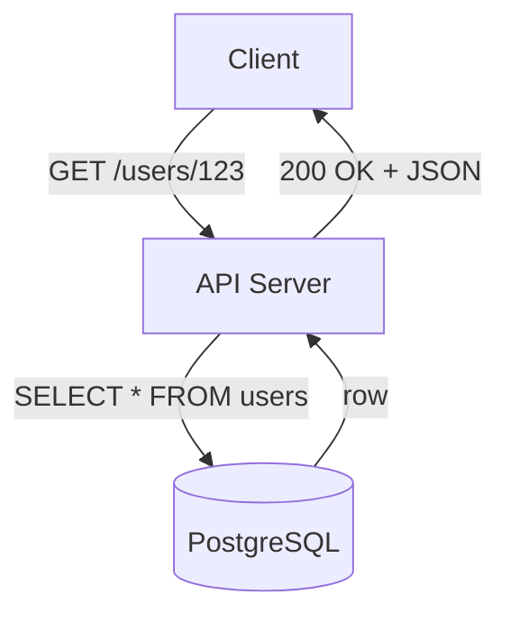
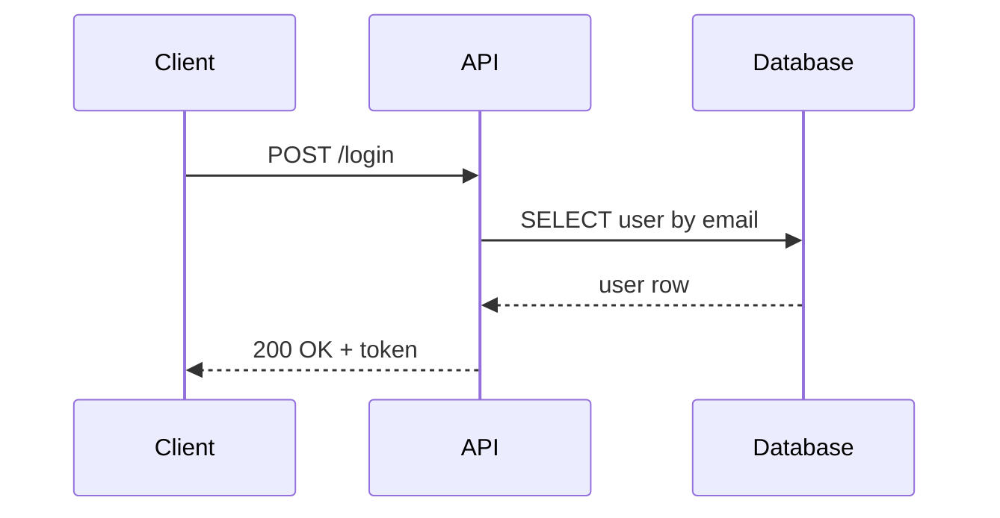
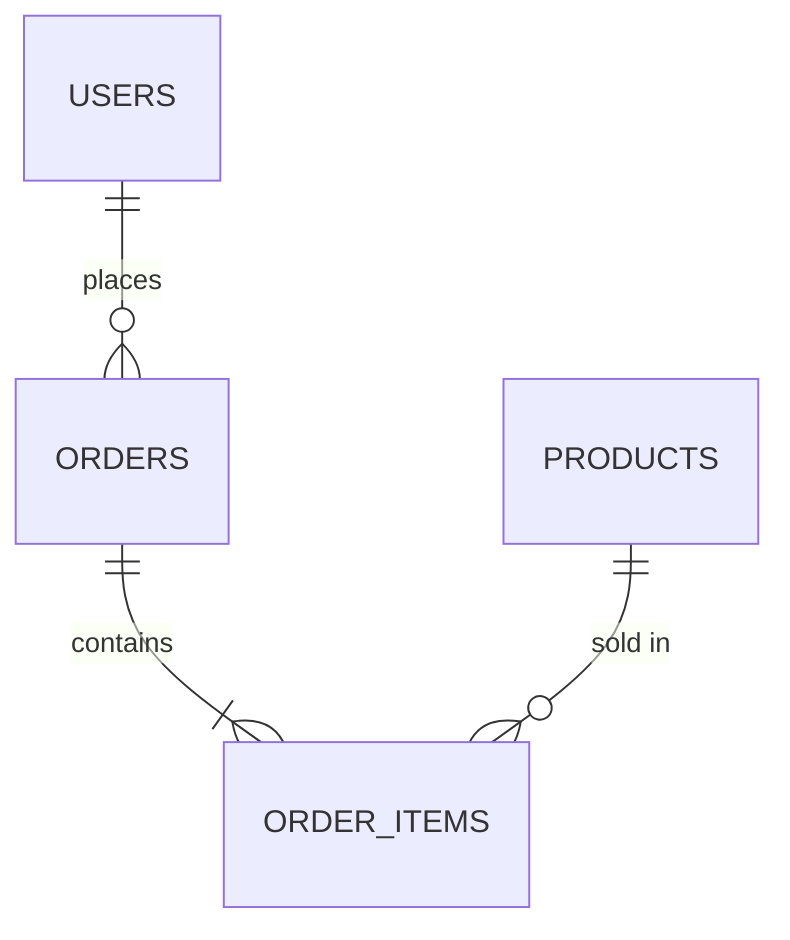

# Technical Diagram Creator

## Goal

Turn a hard-to-picture backend concept into a clear Mermaid diagram that teaches, not decorates.

## When to Use a Diagram

Use a diagram only when it explains relationships or order of steps better than text:

- Request lifecycles (an HTTP request moving through DNS, TCP, TLS, your app).
- Database relationships (foreign keys, joins, table structure).
- Authentication and authorization flows (login, token checks, OAuth).
- API communication (client to server to database).
- System architecture (servers, caches, queues, workers).
- Comparing two designs (sync vs async, vertical vs horizontal scaling).

Do not add a diagram when the topic is short or a table says it better. A simple list is often clearer.

## Choose the Right Diagram Type

| What you show | Use | Mermaid type |
|---|---|---|
| Steps in order, or a decision | Process, lifecycle | `flowchart` |
| Messages between two or more systems | Request/response, auth flow | `sequenceDiagram` |
| Tables and their connections | Data model, joins | `erDiagram` |
| Parts of a system and how they sit together | Architecture | `flowchart` |
| One thing changing over time | Handshake, latency | `timeline` |
| Code structure | Class relations | `classDiagram` |

When unsure, `flowchart TD` (top to bottom) fits most tutorials.

## How to Build the Diagram

1. Write the plain idea in one sentence first (for example: "A client sends a request, the server checks the token, then reads the database").
2. List the actors (Client, Server, Database) and the steps between them.
3. Pick the diagram type from the table above.
4. Write the Mermaid code.
5. Check it renders (see "Verify Before Shipping").
6. Place it near the text it explains.

## Mermaid Rules

- Use short labels. A long sentence inside a box is hard to read.
- Name actors with real words (Client, API, PostgreSQL), not letters (A, B, C).
- Keep the number of boxes small. Under 10 is a good target. Split into two diagrams when it grows.
- Show the failure path when the tutorial teaches failure modes (for example: token missing → 401).
- Prefer `flowchart TD` for vertical flows and `flowchart LR` for wide systems.
- Use `sequenceDiagram` when the order of messages between systems is the point.

### Minimal template (flowchart)

### Minimal template (sequence)

### Minimal template (entity relationship)

## Verify Before Shipping

Mermaid code that fails to render breaks the whole code block. Always check:

- Every line uses valid Mermaid syntax for its diagram type.
- Labels with special characters (parentheses, colons) are wrapped in quotes: `A["API (v1)"]`.
- Relationship labels in `erDiagram` are quoted when they contain spaces.
- Brackets and quotes are balanced.

If a Mermaid renderer tool is available, render it. If not, compare the code against the templates above character by character and say that you could not render it.

## Explain the Diagram in Text

- A diagram does not replace explanation. Write a sentence or two about the important parts.
- Point the reader to what to notice (for example: "Notice the token check happens before any database query").
- Do not repeat every label word for word. Explain the meaning.

## Quality

- Follow the repository's AGENTS.md.
- Keep diagrams in Git-friendly text form (Mermaid). Use images only when Mermaid cannot express the idea.
- Do not add a diagram just to make a tutorial look impressive.
- Match the simple English used in the rest of the tutorial. Diagram labels are part of the tutorial.
