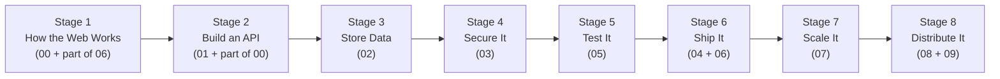

# Backend Learning Roadmap: Where to Start and What Comes Next

`content.md` is the full topic list. It groups topics by **category** (networking, APIs, databases, and so on).

This file is different. It puts the same topics in **learning order**. It answers: what should you learn first, what comes after that, and why.

Rule: **follow the stages in order.** Each stage depends on the stages before it. Do not jump to Stage 6 before you finish Stages 1–5.

## How to Use This Roadmap

1. Start at Stage 1. Move forward one stage at a time.
2. Inside a stage, learn the topics in the listed order.
3. At the end of each stage there is a checkpoint. If you cannot pass it, do not move on yet.
4. If you already know a stage well, skim it and pass its checkpoint, then move on.
5. Tags like `[00]` or `[07]` show which `content.md` section a topic comes from. They help you find the topic in the raw list.

## The Map

Stage numbers are **learning order** (1–8). They are not the same as `content.md` section numbers (00–09). All 10 sections are covered. Some stages merge two sections, and some sections are split across stages.

Section `04 — Production Readiness and Reliability` is not missing. It lives in **Stage 6**. All 9 of its topics are there: config/secrets, twelve-factor, health checks, shutdown, error handling, logging, alerting, timeouts/retries, and incident debugging.

Why this order in one sentence: you cannot build an API without knowing how HTTP works, you cannot secure or test what you have not built, you should not ship or scale what you cannot test, and distributed systems only make sense after you have shipped one working system.

---

## Stage 1 — How the Web Works

Goal: understand what happens when a client talks to a server.

Learn in this order:

1. Backend Architecture and Request Lifecycle `[00]` — the big picture: client → network → server → database → back to client. This is the frame everything else hangs on.
2. Networking Fundamentals — DNS, TCP vs. UDP, connection setup, client-server talk `[00]` — how two machines connect at all. You need this before HTTP makes sense.
3. HTTP and HTTPS — request/response lifecycle, methods, headers, status codes `[00]` — the language of the web. Almost every later topic builds on this.
4. TLS and Connection Management — handshakes, reuse, persistent connections `[00]` — how HTTPS keeps data private and how connections are reused for speed.
5. DNS, Domains, HTTPS, and TLS Termination `[00]` — how a domain name becomes a real server connection, and where encryption stops (the reverse proxy). Needs topics 2–4 first.
6. Web Servers, Application Servers, and Reverse Proxies `[06]` — what Nginx does vs. what your app server does. Placed here (not in Stage 6) because TLS termination only makes sense once you know what a reverse proxy is.
7. Application Hosting and Infrastructure Fundamentals `[06]` — where your server runs. Light version here; deep deployment comes in Stage 6.
8. CORS `[00]` — why browsers block cross-origin requests and how backends allow them. Needs HTTP (topic 3) first.

Checkpoint: explain out loud what happens when you type a URL and press Enter — DNS, TCP, TLS, HTTP request, reverse proxy, app server, response. If you cannot name each step, repeat this stage.

---

## Stage 2 — Build an API

Goal: build a working API with clean structure.

Needs Stage 1, because an API is just HTTP plus structure.

Learn in this order:

1. API Architecture and Request Handling `[01]` — how a request moves through your app: route → middleware → handler → response.
2. Separation of Concerns — controllers, services, repositories, middleware `[01]` — where each piece of code belongs. Learn before writing real endpoints.
3. REST API Design — resources, HTTP methods, idempotency, status codes `[01]` — how to shape URLs and use methods correctly. Needs HTTP (Stage 1) first.
4. Data Serialization, Validation, and Transformation `[01]` — how JSON becomes app objects and back. Needs REST basics first.
5. Input Validation and Trust Boundaries `[01]` — never trust client input; check it at the edge. Pairs with topic 4.
6. Error Handling and Consistent API Responses `[01]` — one error format for the whole API. This is the **API-level** part. App-wide error handling (log it, alert on it, retry it) comes in Stage 6.
7. OpenAPI: The Universal Contract Between Clients and Servers `[01]` — how to describe your API so clients and tests can rely on it. Needs a working API (topics 1–6) first.
8. API Versioning and Compatibility `[01]` — how to change an API without breaking clients. Last, because you only version something that already exists.
9. Concurrency and Parallelism `[00]` — how a server handles many requests at once (threads, processes, event loops).
10. I/O-Bound vs. CPU-Bound Work `[00]` — why waiting on a database is different from heavy math, and why that picks your concurrency model. Needs topic 9 first, and it sets up background jobs in Stage 7.

Checkpoint: build a small CRUD API with clean layers, validated input, one error format, and an OpenAPI doc. Explain why each endpoint uses its HTTP method and status code.

Note: `content.md` lists "Session-Based and Token-Based Authentication" under `[01]` and again under `[03]`. It is taught once, in Stage 4. Stage 2 only needs to know that auth exists.

---

## Stage 3 — Store Data Correctly

Goal: store state without losing or corrupting it.

Needs Stage 2, because your API handlers are what read and write the database.

Learn in this order:

1. Database Fundamentals and Relational Data Modeling `[02]` — tables, rows, keys, and how to model real things as tables.
2. Relationships, Constraints, and Normalization `[02]` — how tables link, how the database rejects bad data, and how to remove duplication.
3. Transactions and ACID Properties `[02]` — how to group writes so they all succeed or all fail. Needs topic 1 first.
4. Transaction Isolation and Concurrency Control `[02]` — what happens when two writes touch the same rows at the same time. Needs topic 3 first.
5. Business Logic and Data Integrity — invariants, atomic operations, race conditions `[02]` — where a rule should live (app vs. database) and how races break it. Needs topics 3–4 first.
6. Indexing Strategies and Trade-offs `[02]` — how indexes speed up reads and slow down writes. Needs modeling (topics 1–2) first.
7. ORMs and Database Abstraction — benefits, limits, generated queries `[02]` — how app code talks to the database. Learn after SQL basics so you can judge what the ORM hides.
8. Connection Pooling `[02]` — why apps reuse database connections instead of opening one per request. Needs ORM/app-server knowledge first.
9. Database Schema Evolution and Migrations `[02]` — how to change table shape safely. Needs topics 1–2 first.
10. Database Performance and Diagnosis — query plans, slow queries, N+1 problems `[02]` — how to find why a query is slow. Last, because it uses everything above. Deep query tuning continues in Stage 7.

Checkpoint: design tables for a small shop (users, orders, items), add one transaction that moves money or stock, explain its isolation level, add one index and say what it costs, and show one N+1 query plus its fix.

---

## Stage 4 — Secure It

Goal: verify who the user is and block common attacks.

Needs Stages 2–3, because login sessions and tokens are stored data, and most attacks target APIs and databases.

Learn in this order:

1. Authentication and Authorization `[03]` — AuthN ("who are you?") vs. AuthZ ("are you allowed?"). The base of everything in this stage.
2. Session-Based and Token-Based Authentication `[03]` — cookies/sessions vs. tokens/JWTs. This is the one canonical place for this topic (it also appears under `[01]` in `content.md`). Needs Stage 2 (HTTP, headers, cookies) and Stage 3 (where sessions live).
3. Cryptography Basics `[03]` — hashing (passwords) vs. encryption (secrets) vs. encoding (transport). Needs topic 2 first, so password storage makes sense.
4. OAuth 2.0 and OpenID Connect `[03]` — "Login with Google" done right. Needs topics 1–2 first.
5. Common Web/API Vulnerabilities — XSS, CSRF, SQL injection, broken access control, IDOR `[03]` — the attacks you must block. Needs API (Stage 2), database (Stage 3), and auth (topics 1–2) first.
6. API Security and Abuse Prevention — rate limiting, brute-force protection, request-size limits `[03]` — how to slow attackers down. Needs topic 5 first.
7. Security Fundamentals and Threat Modeling `[03]` — how to list what can go wrong before it does. Placed after the attacks so the method has real examples to work on.
8. Network Security and Firewalls `[03]` — which traffic may reach your servers at all. Last here because it connects to infrastructure (Stage 6).

Checkpoint: add login to your Stage 2 API, protect one admin-only route, store passwords hashed (never plain), add rate limiting to the login route, and name one threat you blocked at each layer (input, auth, network).

---

## Stage 5 — Test What You Built

Goal: prove your API, database, and auth work — and keep working.

Needs Stages 2–4, because you test the thing you already built.

Learn in this order:

1. Testing Strategies — unit, integration, end-to-end `[05]` — what each test type covers and when to use it.
2. Test Doubles — mocks, stubs, fakes, fixtures `[05]` — how to replace slow or external pieces during tests. Needs topic 1 first.
3. Test Data Management `[05]` — how to create repeatable test data without a mess. Needs topic 2 first.
4. Test Coverage and Test-Driven Development `[05]` — what coverage tells you (and what it hides), and how to write tests first. Needs topics 1–3 first.
5. API Testing and Contract Testing `[05]` — how to test endpoints and keep client/server promises in sync. Needs Stage 2 plus OpenAPI.
6. Database Testing and Transaction Behavior `[05]` — how to test code that writes to a database (rollbacks, isolation). Needs Stage 3.
7. Authentication and Authorization Testing `[05]` — how to test login, permissions, and blocked access. Needs Stage 4. Last, because it stacks on API + database + auth testing.

Checkpoint: your API has unit tests for logic, integration tests for endpoints + database, and at least one test that proves an unauthorized user is blocked.

---

## Stage 6 — Ship It to Production

Goal: run your tested app on real servers, safely.

Needs Stages 1–5. Shipping untested or insecure code is how outages happen.

Learn in this order:

1. DevOps and Infrastructure Fundamentals `[06]` — the big picture of shipping: build, test, deploy, run.
2. Production Configuration and Secrets Management `[04]` — config per environment, secrets never in code. First practical step before anything touches a server.
3. The Twelve-Factor App `[04]` — twelve rules for apps that deploy cleanly. Read early; apply through the whole stage.
4. Containerization — Docker `[06]` — how to pack your app so it runs the same everywhere. Needs topic 2 first.
5. CI/CD and Deployment Automation `[06]` — how tests run on every push and good builds deploy by themselves. Needs Stage 5 (tests) plus topic 4.
6. Deployment Strategies and Rollbacks `[06]` — how to release without downtime and how to undo a bad release. Needs topic 5 first.
7. Database Migrations in Production `[06]` — how to change live tables without losing data. Needs Stage 3 plus topic 6.
8. Database Backups and Recovery `[06]` — how to restore data after something bad. Pairs with topic 7. Practice restores, not just backups.
9. Health Checks and Production Readiness `[04]` — how your app tells the platform "I am ready" or "I am sick". Needs topics 4–6 first.
10. Graceful Shutdown `[04]` — how your app finishes current work before stopping. Pairs with topic 9; deployers need both.
11. Error Handling `[04]` — app-wide: catch, log, and classify errors. This is the **production** part (the API response format was Stage 2).
12. Logging, Monitoring, and Observability `[04]` — how to see what your app is doing in production. Needs topic 11 first.
13. Error Tracking and Alerting `[04]` — how to wake someone when it breaks. Needs topic 12 first.
14. Timeouts and Retries `[04]` — how to call other services without hanging forever. Needs topics 12–13 so retries are visible, not silent.
15. Production Incident Debugging `[04]` — how to find the cause during an outage. Last: it uses the whole stage.

Checkpoint: deploy your app with Docker + CI/CD, secrets outside code, health checks on, logs and alerts working, a tested backup restore, and one practiced rollback.

---

## Stage 7 — Scale It

Goal: handle more traffic and heavier work without breaking.

Needs Stage 6, because you scale a system that already runs in production. Scaling a system you cannot observe or deploy is guesswork.

Learn in this order:

1. Latency, Throughput, and Performance `[07]` — what to measure before you change anything.
2. Performance Profiling and Bottleneck Diagnosis `[07]` — how to find the slowest part. Needs topic 1 first. Never optimize without this step.
3. Database Query Optimization `[07]` — advanced tuning that builds on Stage 3 (indexing, query plans, N+1).
4. Pagination `[07]` — offset vs. cursor, and why one dies at scale. Needs topic 3 first; it is the cheapest database load fix.
5. Caching Fundamentals and Invalidation `[07]` — what to cache, where, and when to throw it away. Needs Stage 3 (data) and measurement (topics 1–2) first.
6. Object Storage `[07]` — where files live (not in your database). Independent of caching, but placed here because file serving is a scaling question.
7. Background Jobs and Task Queues `[07]` — how to move slow work off the request path. Needs Stage 2 (I/O vs. CPU-bound) plus topics 1–2.
8. Reliable Asynchronous Processing — idempotency, retries, duplicate delivery `[07]` — how to make background work correct when messages arrive twice. Needs topic 7 first.
9. Scalability `[07]` — vertical vs. horizontal, stateless design. Last: it sums up the whole stage.

Checkpoint: take a slow endpoint, profile it, make it fast with one fix (index, pagination, or cache), move one slow task to a queue with safe retries, and explain why your app can or cannot run on two servers.

---

## Stage 8 — Distribute It and Design Systems

Goal: reason about many servers working as one, and practice system design.

Needs all stages before it. Distributed ideas assume you already know networking, APIs, databases, auth, shipping, and scaling.

Learn in this order:

1. Load Balancing `[08]` — how traffic spreads across servers. Listed here (not earlier) because it only matters once you run more than one server (Stage 7).
2. Distributed Systems Concepts `[08]` — nodes, partitions, replication, leaders and followers. Needs topic 1 first.
3. Consistency and Availability `[08]` — what each means for your users when parts fail. Needs topic 2 first.
4. CAP Theorem `[08]` — why you cannot have it all during a network split. Needs topic 3 first.
5. Fault Tolerance and Redundancy `[08]` — how to survive failures. Needs topics 2–4 first.
6. Capacity Planning and Resource Management `[08]` — how much hardware you need and when to add more. Needs Stage 7 measurement plus topics 1–5.
7. Full-Text Search Using Elasticsearch for Blazingly Fast Search `[08]` — one real distributed tool, used as a case study. Needs topics 2–5 first so its trade-offs make sense.
8. System Design in Practice `[09]` — design whole systems from the pieces above. This is the capstone. `content.md` lists the section with no sub-topics yet; treat it as practice tasks (URL shortener, rate limiter, feed, chat) that combine Stages 1–8.

Checkpoint: design a small system on paper (for example a URL shortener): draw clients, load balancer, app servers, database, cache, and queue. State your CAP choice, what breaks first under load, and how you would know.

---

## Topic Index — Nothing Is Lost

Every topic from `content.md`, and the stage where it is taught:

| `content.md` section | Topic | Taught in |
|---|---|---|
| 00 | Backend Architecture and Request Lifecycle | Stage 1 |
| 00 | Networking Fundamentals | Stage 1 |
| 00 | HTTP and HTTPS | Stage 1 |
| 00 | TLS and Connection Management | Stage 1 |
| 00 | Concurrency and Parallelism | Stage 2 |
| 00 | I/O-Bound vs. CPU-Bound Work | Stage 2 |
| 00 | DNS, Domains, HTTPS, and TLS Termination | Stage 1 |
| 00 | CORS | Stage 1 |
| 01 | API Architecture and Request Handling | Stage 2 |
| 01 | Separation of Concerns | Stage 2 |
| 01 | REST API Design | Stage 2 |
| 01 | Data Serialization, Validation, Transformation | Stage 2 |
| 01 | OpenAPI | Stage 2 |
| 01 | API Versioning and Compatibility | Stage 2 |
| 01 | Error Handling and Consistent API Responses | Stage 2 (API format) |
| 01 | Session-Based and Token-Based Authentication | Stage 4 (taught once) |
| 01 | Input Validation and Trust Boundaries | Stage 2 |
| 02 | Database Fundamentals and Relational Modeling | Stage 3 |
| 02 | Relationships, Constraints, Normalization | Stage 3 |
| 02 | Business Logic and Data Integrity | Stage 3 |
| 02 | Transactions and ACID | Stage 3 |
| 02 | Transaction Isolation and Concurrency Control | Stage 3 |
| 02 | Indexing Strategies and Trade-offs | Stage 3 |
| 02 | Database Performance and Diagnosis | Stage 3 (basics; advanced in Stage 7) |
| 02 | ORMs and Database Abstraction | Stage 3 |
| 02 | Schema Evolution and Migrations | Stage 3 |
| 02 | Connection Pooling | Stage 3 |
| 03 | Authentication and Authorization | Stage 4 |
| 03 | OAuth 2.0 and OpenID Connect | Stage 4 |
| 03 | Session-Based and Token-Based Authentication | Stage 4 (canonical) |
| 03 | Cryptography Basics | Stage 4 |
| 03 | Common Web/API Vulnerabilities | Stage 4 |
| 03 | API Security and Abuse Prevention | Stage 4 |
| 03 | Network Security and Firewalls | Stage 4 |
| 03 | Security Fundamentals and Threat Modeling | Stage 4 |
| 04 | Production Configuration and Secrets | Stage 6 |
| 04 | Logging, Monitoring, Observability | Stage 6 |
| 04 | Error Tracking and Alerting | Stage 6 |
| 04 | Error Handling | Stage 6 (app-wide; API format was Stage 2) |
| 04 | Timeouts and Retries | Stage 6 |
| 04 | Graceful Shutdown | Stage 6 |
| 04 | Health Checks and Production Readiness | Stage 6 |
| 04 | Production Incident Debugging | Stage 6 |
| 04 | The Twelve-Factor App | Stage 6 |
| 05 | Testing Strategies | Stage 5 |
| 05 | Test Doubles | Stage 5 |
| 05 | Test Data Management | Stage 5 |
| 05 | Test Coverage and TDD | Stage 5 |
| 05 | API Testing and Contract Testing | Stage 5 |
| 05 | Database Testing and Transaction Behavior | Stage 5 |
| 05 | Authentication and Authorization Testing | Stage 5 |
| 06 | Web Servers, App Servers, Reverse Proxies | Stage 1 (basics for TLS/proxy) |
| 06 | Containerization — Docker | Stage 6 |
| 06 | CI/CD and Deployment Automation | Stage 6 |
| 06 | Application Hosting and Infrastructure | Stage 1 (light) → Stage 6 (full) |
| 06 | Database Backups and Recovery | Stage 6 |
| 06 | Database Migrations in Production | Stage 6 |
| 06 | Deployment Strategies and Rollbacks | Stage 6 |
| 06 | DevOps and Infrastructure Fundamentals | Stage 6 |
| 07 | Latency, Throughput, Performance | Stage 7 |
| 07 | Performance Profiling and Bottlenecks | Stage 7 |
| 07 | Database Query Optimization | Stage 7 |
| 07 | Caching Fundamentals and Invalidation | Stage 7 |
| 07 | Background Jobs and Task Queues | Stage 7 |
| 07 | Reliable Async Processing | Stage 7 |
| 07 | Object Storage | Stage 7 |
| 07 | Scalability | Stage 7 |
| 07 | Pagination | Stage 7 |
| 08 | Distributed Systems Concepts | Stage 8 |
| 08 | Consistency and Availability | Stage 8 |
| 08 | CAP Theorem | Stage 8 |
| 08 | Fault Tolerance and Redundancy | Stage 8 |
| 08 | Load Balancing | Stage 8 |
| 08 | Capacity Planning and Resource Management | Stage 8 |
| 08 | Full-Text Search with Elasticsearch | Stage 8 |
| 09 | System Design in Practice | Stage 8 (capstone; sub-topics open) |

Two topics appear twice in `content.md` and are taught once: session/token auth (Stage 4) and error handling (split: API format in Stage 2, app-wide handling in Stage 6).
