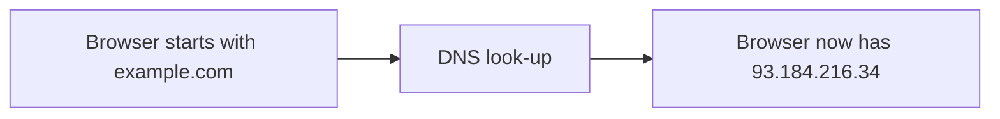
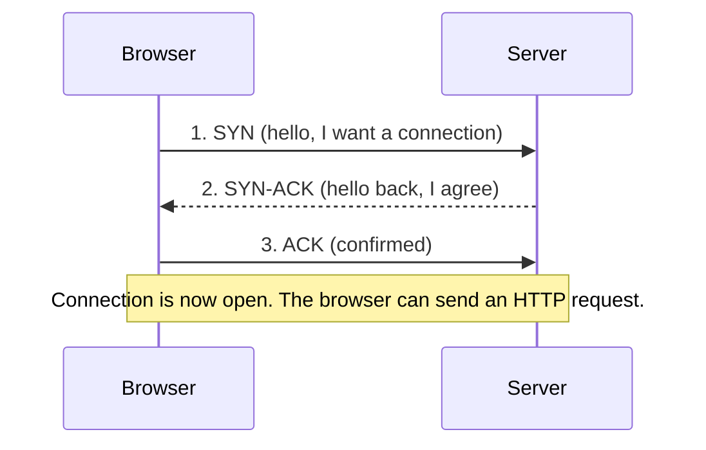
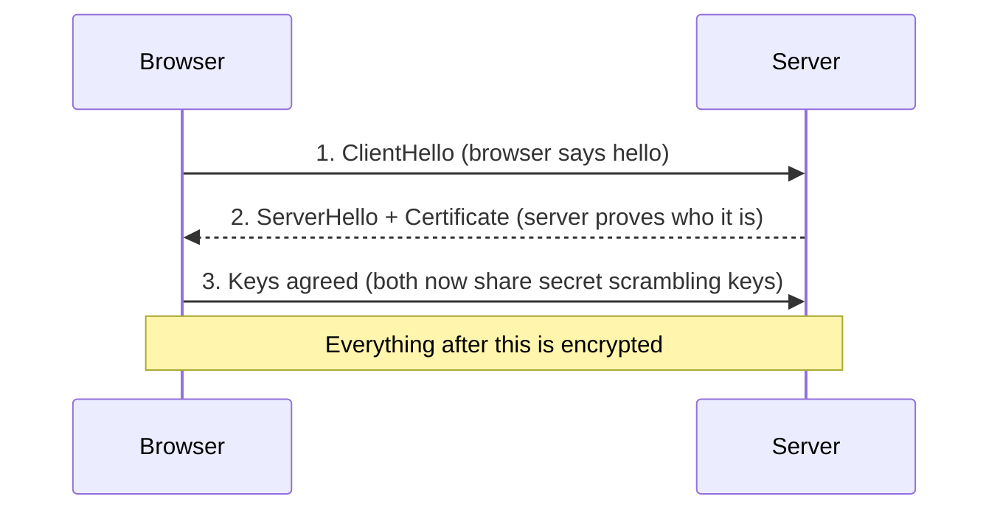
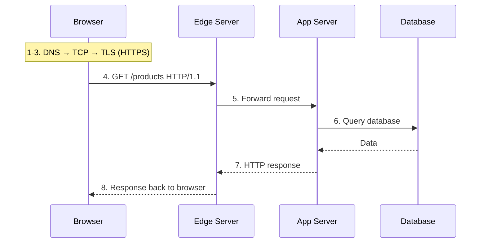
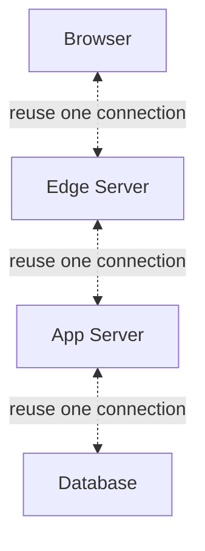
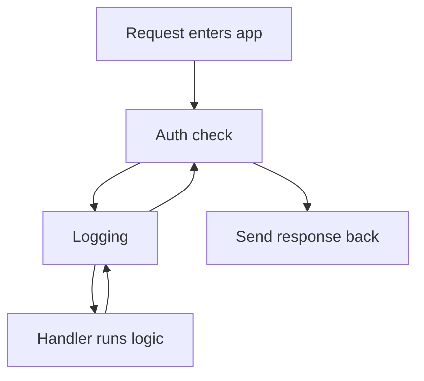

# Backend Architecture and the Request Lifecycle

## Why It Matters

When something breaks in a backend, the error you see is rarely where the cause is.

You see "the page is slow" or "I got a 500 error." But the cause could be:
- The name-to-number look-up going wrong.
- A secure-connection setup that fails.
- The front door returning a 500 while the code behind it logged nothing.
- A data lookup that makes the code freeze for 30 seconds.
- A step in the app that stops and never sends a response.

This topic gives you the full map. It follows one request, hop by hop, and defines each piece as it comes. When you can name every hop, you know where to look when things go wrong. That is the difference between guessing and debugging.

## What It Is

The **request lifecycle** is the full journey a single request takes, from "I pressed Enter" to "I got my page." Every backend — no matter the language or framework — follows the same path. The request goes **down**, through a set of layers (a level in the path, one after another), then the response comes **back up** through the same layers in reverse.

That round trip is the big picture. Everything else in this roadmap fills in one layer at a time.

## How It Works

We follow one request from the moment you press Enter until the page loads. Each hop causes the next.

### 1. The browser needs to find the server

You type `example.com`. That is a **domain name** — a human-readable address. Computers do not understand names. They talk in **IP addresses**, which are numbers like `93.184.216.34`.

**DNS** (Domain Name System) turns the name into the number. Think of it as a phone book for the internet. Without DNS, you would have to memorize a string of numbers for every site you visit.



The browser starts with a name and ends with a number. That number is the destination it will call in the next step.

> DNS is its own topic later. For now: it is the "name to number" look-up.

### 2. The browser calls that number

The browser now has an IP address. It needs to start a conversation with the server at that address. That conversation runs over **TCP** (Transmission Control Protocol). TCP is the protocol that opens a reliable connection between two computers.

"Reliable" means two things: the data arrives in order, and nothing gets lost without notice. Before any real data flows, the two sides do a **three-way handshake** — they send hello messages back and forth three times to confirm the line works. Only then do they start sending data.

This is what those three messages look like:



The browser and server each send one message to confirm both sides agree the line is open before any real data moves.

> TCP is its own topic later. For now: it is the "open a reliable phone line" step.

### 3. The line is made private (HTTPS)

If the URL starts with `https://`, the browser and server need to scramble the conversation so no one listening can read it. That is **TLS** (Transport Layer Security).

The browser and server run a **TLS handshake**. They agree on secret scrambling keys, and the website proves who it is using a **digital certificate** — a signed document that says "this server really is example.com." After this, everything sent over the connection is encrypted (scrambled into unreadable form).



This mirrors the TCP handshake above: a few messages are exchanged before any real data, then the connection is ready. The extra piece is proving identity (the certificate) and agreeing on scrambling keys.

**HTTPS** just means HTTP sent over such an encrypted line. That is what the lock icon in your browser means.

> TLS is its own topic later. For now: it is the "lock down the line and prove who is on the other end" step.

### 4. The browser speaks HTTP

Now that there is a private, reliable line, the browser sends a request in **HTTP** (HyperText Transfer Protocol) — the language of the web. A request is a short text message, like:

```
GET /products HTTP/1.1
Host: example.com
```

This is the simplest possible HTTP request. A real HTTP request has four parts:

| Part | Example | Meaning |
|---|---|---|
| Request line | `GET /products HTTP/1.1` | `GET` = the method (the action), `/products` = the path (which page), `HTTP/1.1` = the version |
| Header | `Host: example.com` | metadata about the request (where it is going) |
| Blank line | (empty) | marks the end of the headers |
| Body | (empty for GET) | content sent to the server (POST uses this; GET leaves it empty) |

This says "give me the page at /products on example.com." The server promises a reply: a **status code and message** (for example `200 OK` means success, `404 Not Found` means no such page) plus a body (the page content).

> HTTP is its own topic later. For now: it is the "request and reply message" step.

### 5. The edge server receives it

The server at the IP address is usually not your application directly. It is an **edge server** — the front door of your application. This is software (for example Nginx) that sits in front of your app.

An edge server receives the client request and passes it to the application that runs your code. It can also block traffic it thinks is bad, and serve some replies from its own memory instead of asking the app. Doing these tasks in the edge server keeps your application simple and protects it.

> Edge servers are explained in their own topic. For now: it is the "gatekeeper that receives client requests before they reach your application."

### 6. The app server runs your code

The edge server forwards the request to your **app server** — the program (and the machine running it) that holds your application logic. The app server receives requests, decides what to do, and returns replies.

> The app server is the layer that Stages 2 and 6 cover in depth. For now: it is "the program that runs your code."

### 7. The handler and the database

Inside the app server, the request reaches a **handler** — the piece of code responsible for this one URL. The handler does the work. Most of the time, that work is reading or writing a **database** — a structured store of your app's data (users, orders, products). The handler reads or writes data, then builds a reply.

> Databases are the whole point of Stage 3. For now: it is the "store and read the real data" hop.

### 8. The response travels back

The response then travels back through the same path, in reverse:

```
Database → handler → app server → edge server → browser
```

One key point the diagram shows: the browser only ever talks to the edge server. It cannot reach the database directly. All data access goes through the app — which is exactly why access control and query safety must live in the app, never in the browser.

This is the part most people miss. The response unwinds backward. If anything in the app stops or errors while sending the response back, the client gets a late or missing reply even though the handler finished.

This whole journey, end to end:



## Why connections are reused

Steps 1 to 3 (DNS, TCP, TLS) are expensive. HTTP/1.1 avoids repeating them for every resource with **keep-alive** (a persistent connection): one connection carries many requests.

This reuse is **hop-by-hop** — meaning it applies separately at each hop (each connection between two points). That is why the browser, the edge server, and the app server do not share one connection — each pair keeps its own:
- The browser keeps one connection to the edge server.
- The edge server keeps a separate connection to the app server.
- The app server keeps a separate connection to the database.



Each arrow is a separate persistent connection used between just that pair of components. The browser, edge, and app each keep their own pool — reusing the browser-to-edge connection does not give the edge any connection to the app.

So when a page loads HTML, CSS, and JS, the browser reuses its connection to the edge instead of handshaking three times. This is also why "running out of idle connections" is a real failure mode.

## Inside the app: the middleware chain

Inside the app server, the request does not jump straight to the handler. It passes through a chain of small processors called **middleware**. Each one does a single job and then hands off to the next. The request moves forward through the chain, and the response moves back through the same chain in reverse:



Concrete example. A request to view an account:

1. **Auth step** checks that you are logged in. If not, it sends a `401` and the chain stops. Nothing later runs.
2. **Logging step** records the request.
3. **Handler** runs: reads the user, builds the profile.
4. The handler returns the response, which unwinds back through logging, then auth, then to the client.

A common bug: a middleware that neither sends a response nor hands off to the next step. The chain stops, the request hangs, and the browser times out.

## Walkthrough: typing `google.com`

Now we put it all together. You type `google.com` and press Enter:

1. **Type URL.** The browser needs Google's IP number.
2. **DNS.** The browser looks up `google.com` and gets an IP number.
3. **TCP.** The browser calls that number (three-way handshake).
4. **TLS.** For HTTPS, the browser and server do the TLS handshake and verify Google's certificate.
5. **HTTP request.** The browser sends `GET / HTTP/1.1` over the encrypted connection.
6. **Edge server.** Google's edge receives it. It may answer from memory, or pass it to an app server.
7. **App server.** The app runs its steps (auth, logging, handler) and reads your feed.
8. **Database.** The handler reads your personalized feed from storage.
9. **Response back.** The response travels back: handler → app → edge → browser, reusing the connection from step 3.
10. **Browser renders.** The browser parses the page and asks for more (CSS, JS, images), over the same connection.

This is why each layer matters: a problem in any hop breaks the whole journey, and the symptom you see depends on which hop failed.

## Trade-offs

- **Where TLS ends.** Ending TLS at the edge server saves your app from encryption work. But traffic between edge and app is then unencrypted on the private network. End-to-end TLS (the app also gets TLS) is safer on a hostile network; edge termination is simpler to run. Choose based on your network.
- **One app server vs. many.** One app server is easy to debug (logs live in one place). Many app servers add redundancy and scale, but now a bug can be "works on server A, not server B." Scale only when you need it.
- **Where the work happens.** The handler is where your logic lives, but every database round trip costs time. Doing or storing work before it reaches the database is the highest-leverage fix. This topic shows where that hop sits; Stage 3 and Stage 7 teach how to make it faster.

## Failure Modes

- **Treating the round trip as one-way.** You fix the request path and forget the response path. The handler succeeds, but the app never sends the response back. Always trace both directions.
- **Ignoring connection reuse.** Assuming each HTTP request pays the full DNS + TCP + TLS cost hides real latency. Most requests reuse an existing connection, which is why "running out of idle connections" is a real failure.
- **Blindly trusting the edge.** A 500 from the edge server may be its own error page, not a problem in your app. Check the edge logs as well as the app logs. Two sets of logs matter.
- **The middleware that swallows the request.** A step in the app that neither responds nor hands off hangs the request. Make sure every step passes control forward.

## Key Takeaways

- A request is a round trip: it enters at a layer and returns through the same layers in reverse.
- The hops are: browser → DNS → TCP → TLS → HTTP → edge server → app server → database → handler → response back.
- Each layer above is its own concept. You do not need all the details today — just know they exist and which is which.
- Connections are reused, hop by hop, so the browser, edge, and app each keep their own pools.
- The database is usually the slowest and most-likely-to-fail hop, so it is where to look first when something is slow or broken.

## Knowledge Check

1. Put these hops in order for an HTTPS request: HTTP request, TLS handshake, TCP connection, DNS look-up, edge server forwards to app.
2. True or false: with keep-alive, loading one page with 15 resources opens 15 separate TCP+TLS connections. If false, what happens instead?
3. A request gets a 500 from the edge server, but the app server logs are empty. Where do you look, and what likely happened?

## Related Topics

This is Stage 1's big-picture topic. The hops below are covered in depth in later Stage 1 topics (see [main.md](main.md)):

- **DNS and TCP** — "Networking Fundamentals."
- **TLS, HTTPS, and connection reuse** — "TLS and Connection Management" and "DNS, Domains, and TLS Termination."
- **HTTP** — "HTTP and HTTPS."
- **Edge servers and app servers** — "Web Servers, Application Servers, and Reverse Proxies."
- **The handler inside the app** — Stage 2's "API Architecture and Request Handling."

## References

- RFC 9112, HTTP/1.1 messaging — https://httpwg.org/specs/rfc9112.html (the HTTP protocol specification).
- MDN: Connection management in HTTP/1.x — https://developer.mozilla.org/en-US/docs/Web/HTTP/Guides/Connection_management_in_HTTP_1.x (verified: persistent connections are hop-by-hop and are the default in HTTP/1.1).
