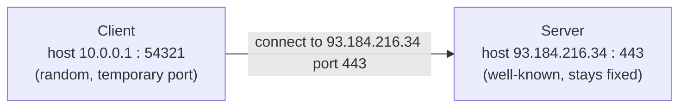
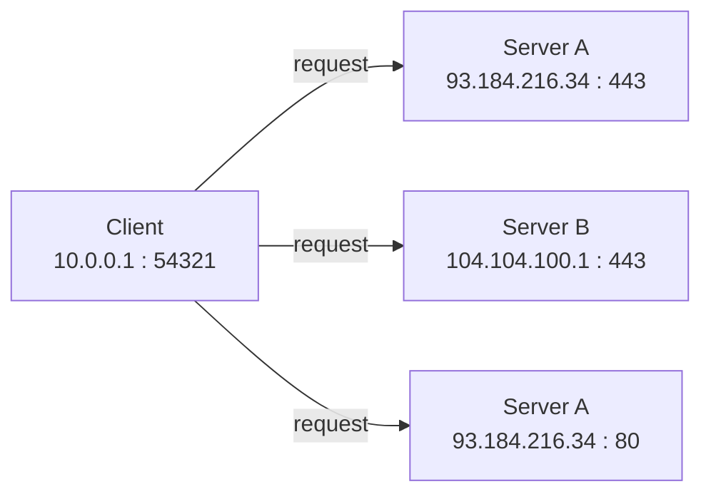
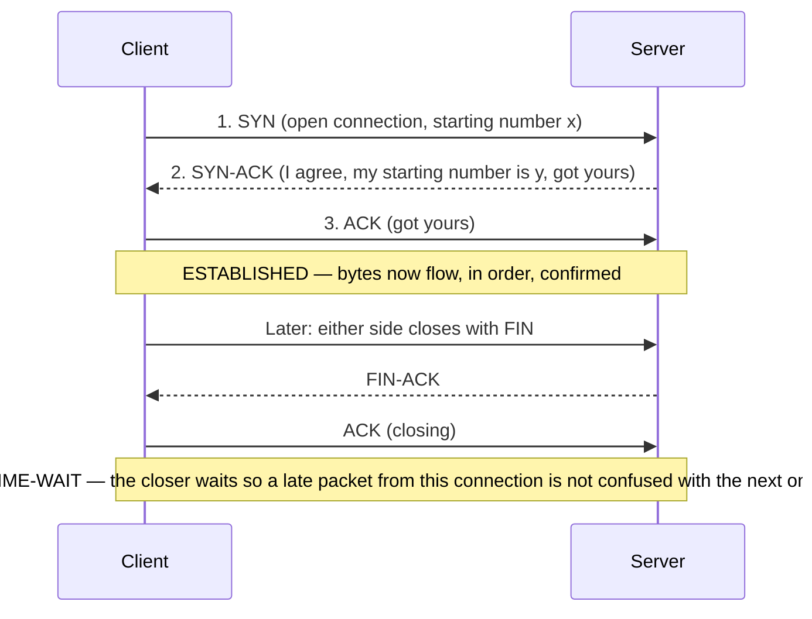
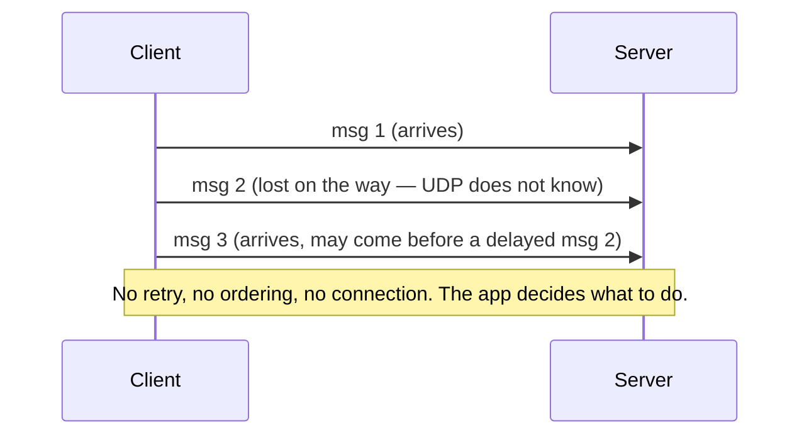

# Networking Fundamentals

## Why It Matters

When something is slow or broken between services, the cause is often not your code — it is the connection itself. A program cannot reach the one it needs. It can reach it, but messages arrive out of order. It can reach it, but the connection drops halfway.

These come from how two programs agree to talk, and from how they notice when the line goes dead.

This topic explains the two ways programs trade data across the internet: one that guarantees delivery and order, and one that sends fast messages with no promises. When you know which one your tools use and how each opens and closes, connection errors stop being magic.

## What It Is

Data crosses the internet in small chunks called **packets**. A **host** is one machine, and it is identified by an **IP address** — a number, like `93.184.216.34`. But one computer usually runs many programs at once. So a **port** says which program should receive the packet. An IP address plus a port is an **endpoint** — one specific program on one specific computer. For example, `93.184.216.34:443` means "the program on port 443 of that computer."

The **transport layer** sits between the network and the application:

- Below it is **IP**, which moves packets between hosts. It does not guarantee they arrive.
- Above it is the application (for example HTTP).

The transport layer's only job is to deliver data between two endpoints. It offers two main choices:

- **TCP** (Transmission Control Protocol): a **reliable, ordered, connection-oriented** pipe between two endpoints. It opens a connection first, numbers every byte, confirms the numbers, and resends anything that is lost.
- **UDP** (User Datagram Protocol): a **connectionless, best-effort** messenger. It sends a message and does not wait to see if it arrived.

> TCP and UDP are deep topics of their own later. For now: TCP = a reliable pipe; UDP = a fast messenger with no promises.

## How It Works

### The client-server model and addressing

In most internet traffic, one side waits for a call and the other makes it. The side that calls is the **client**. The side that waits is the **server**. The server listens on a **well-known port** — port 80 for HTTP, port 443 for HTTPS. The client calls that port. The server answers.

One computer usually keeps several connections open at the same time. Each connection is a unique four-number combination, so the same client can reach different servers (even on the same port) without mixing the replies.

Because the four numbers (client IP, client port, server IP, server port) stay unique per connection, replies always land on the right one. That is how one client can talk to many servers, and one server to many clients, at once.

The server uses a well-known port so clients always know where to knock. The client uses a random temporary port so replies come back to the right program on the client.

### TCP: open a reliable pipe

Before any data flows, the two endpoints open a connection with a **three-way handshake**:

1. The client sends a **SYN** ("I want to connect; here is my starting number").
2. The server replies **SYN-ACK** ("I agree; here is my starting number; I got yours").
3. The client sends an **ACK** ("I got yours").

Now the connection is **ESTABLISHED**. Bytes flow in order and are confirmed. If a byte is lost, TCP resends it.

This is the same three-way handshake shown in the request-lifecycle topic, now drawn as a full lifecycle: open, transfer data, then close. The close is also a multi-message exchange (FIN, FIN-ACK, ACK), and the side that closes first enters **TIME-WAIT** — a short wait that prevents a delayed packet from the old connection from being misread as part of the next one.

> A full TCP connection passes through many states (CLOSED, LISTEN, SYN-SENT, SYN-RECEIVED, ESTABLISHED, FIN-WAIT-1, FIN-WAIT-2, CLOSE-WAIT, CLOSING, LAST-ACK, TIME-WAIT, back to CLOSED). That state map is the subject of RFC 9293. For now: a connection is opened with a handshake, moves an ordered byte stream, and is closed with a FIN exchange; the closer then waits in TIME-WAIT.

### UDP: send a message and forget

UDP has no handshake and no connection. The application just hands a message to UDP; UDP wraps it in a small 8-byte header (source port, destination port, length, checksum) and IP sends it. That is all.

| Property | TCP | UDP |
|---|---|---|
| Connection setup | One is opened first (three-way handshake) | None — send a message right away |
| Delivery | Guaranteed (losses are resent) | No guarantee; lost messages stay lost |
| Order | Bytes arrive in the order sent | Messages can arrive out of order |
| Overhead | Larger header + connection state | 8-byte header, no state |
| Data model | An ordered stream of bytes | Independent messages (datagrams) |
| When to use | A full conversation (a web page, a file, a database call) | Fast, standalone messages (a video frame, a DNS query, a game position) |

Compared with TCP, UDP trades reliability and ordering for speed and simplicity. Pick TCP when the message must arrive in order; pick UDP when you need it fast and are willing to handle loss yourself.

UDP never retries, never waits, and never tells you something arrived. It just sends. If your app needs reliability, you must build it yourself — sequence numbers, retries, timeouts. That is why video calls and online games use UDP (a dropped frame is better than a frozen call), while web pages and database queries use TCP.

### DNS: the name to number step

To open a TCP connection, the client needs an IP address. People use names. **DNS** turns a name (`example.com`) into a number (an IP address) — it is the phone book from the request-lifecycle topic. At this layer it is just the first thing that must happen before a connection opens.

## Walkthrough: one connection, from start to end

A browser loads `https://example.com/products`:
1. **DNS.** The browser asks DNS for `example.com` and gets `93.184.216.34`.
2. **Pick the server.** It will talk to port 443 (HTTPS). The server is listening there.
3. **TCP open.** The client (random port 54321) sends SYN → the server (port 443) replies SYN-ACK → the client sends ACK. The connection is now ESTABLISHED.
4. **TLS.** Over the TCP pipe, the client and server run the TLS handshake (covered in the TLS topic) to encrypt it.
5. **HTTP.** The client sends `GET /products` over the now-secure TCP pipe.
6. **Data.** The server's program reads the request, runs its code, and sends bytes back over the same pipe.
7. **TCP close.** Either side sends FIN; the other replies FIN-ACK; the closer enters TIME-WAIT, then frees the port.

Each layer reuses the connection from the previous one. The TCP connection opened in step 3 is the same pipe TLS uses in step 4 and HTTP uses in step 5. One connection, three layers stacked on top.

## Trade-offs

- **TCP vs. UDP.** TCP's reliability costs one round trip to open (plus retransmit latency when packets are lost) and memory to track state. UDP has no setup cost and no state, but no promises. Choose TCP for "the message must arrive in order"; choose UDP for "I want it fast and will handle loss myself."
- **Connection-oriented vs. connectionless.** TCP needs a handshake, so the first packet to a server is slower. UDP is send-first, so it is faster for one-shot messages — but the server cannot tell who is calling unless the app records it.
- **Well-known vs. temporary ports.** Well-known ports (80, 443) let clients find servers by agreement. Temporary ports let one client talk to many servers at once. The trade-off: a server on a fixed port is a known target; a client must let the OS pick a free port (these can run out under load — see Failure Modes).

## Failure Modes

- **Connection refused.** The client sends SYN, but no program is listening on that port. The host replies with a reset (RST). Result: "connection refused." Check that the server is running and listening on the right port.
- **Timeout (no reply at all).** The client sends SYN, gets no reply (maybe a firewall drops it). TCP retries, then gives up. Result: "timed out." The server never saw the request — so checking server logs alone will not help.
- **Temporary-port exhaustion.** A client opens many short-lived connections and closes them. Each closer keeps its port in TIME-WAIT for a while. Under heavy load, the client can run out of temporary ports to assign. (This is the same idea as "running out of idle connections" in the request-lifecycle topic.)
- **UDP: silent loss and reordering.** A datagram is dropped, arrives out of order, or is duplicated. UDP never tells you. The application must detect it (sequence numbers, timeouts) or accept the loss.
- **Confusing reliability with speed.** TCP guarantees the bytes reach the application in order, but the network still drops, reorders, and retransmits underneath. Assuming "TCP = never slow" hides real problems like congestion or queue buildup.

## Key Takeaways

- The transport layer moves data between two endpoints (IP + port). TCP is reliable and ordered; UDP is fast and best-effort.
- TCP opens with a three-way handshake, moves an ordered byte stream, and closes with a FIN exchange (the closer waits in TIME-WAIT first).
- UDP sends independent datagrams with an 8-byte header: no handshake, no ordering, no retransmission. The application handles reliability.
- Servers listen on well-known ports (80, 443); clients use random temporary ports. Four numbers (two IPs + two ports) identify one connection.
- DNS (covered in the request-lifecycle topic) turns a name into the IP the client needs before it can open the TCP connection.

## Knowledge Check

1. Your web app uses TCP for API calls and UDP for live game messages. Explain why each protocol fits its job.
2. True or false: with UDP, if the server never replies, UDP will retransmit the datagram until it gets an acknowledgment. If false, who retransmits it?
3. A TCP request finishes successfully, then the server closes the connection (sends FIN). Why isn't the server's single FIN enough — why must the client send something back?

## Related Topics

This is Stage 1's networking layer. It connects to:

- **Backend Architecture and the Request Lifecycle** — where DNS, TCP, TLS, and HTTP first appeared as hops in a request. *(Read it first if you want the big picture.)* [Link](backend-architecture-and-request-lifecycle.md)
- **HTTP and HTTPS** — the application that rides on top of TCP.
- **TLS and Connection Management** — how the TCP pipe gets locked with HTTPS, and how connections are reused for speed.
- **DNS, Domains, HTTPS, and TLS Termination** — a deeper look at DNS, domain names, and where encryption ends.

## References

- RFC 9293, Transmission Control Protocol (TCP), including the connection state diagram — https://www.rfc-editor.org/rfc/rfc9293 (the current TCP specification; RFC 793 is the original).
- RFC 768, User Datagram Protocol (UDP) — https://www.rfc-editor.org/rfc/rfc768.
- RFC 1034, Domain Names — https://www.rfc-editor.org/rfc/rfc1034 (DNS: how names turn into IP addresses).
- IANA Service Name and Port Number Registry — https://www.iana.org/assignments/service-names-port-numbers/service-names-port-numbers.xhtml (which ports mean what; for example 80 = HTTP, 443 = HTTPS).
- MDN: Connection management in HTTP/1.x — https://developer.mozilla.org/en-US/docs/Web/HTTP/Guides/Connection_management_in_HTTP_1.x (how browsers reuse TCP connections after this topic).

